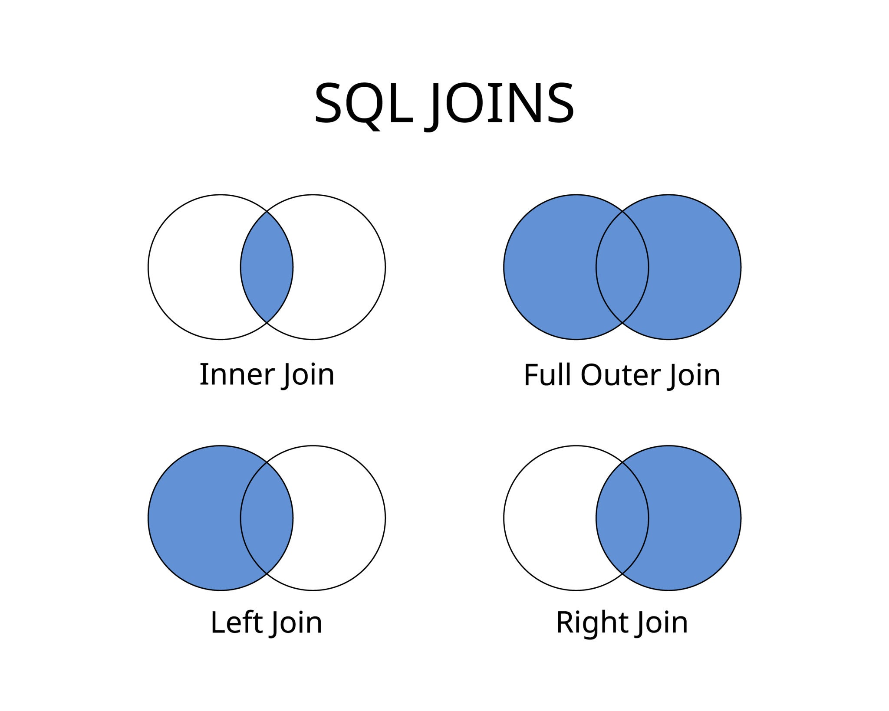

# SQL JOINs

A SQL JOIN clause is used to combine rows from two or more tables based on a related column between
them (usually a primary and a foreign key).



## Tables

Customers

| customer_id   |     name      |
| ------------- | ------------- |
| 1             |     Alice     |
| 2             |     Bob       |
| 3             |     Charlie   |

Orders

| order_id   |  customer_id  |
| -----------| ------------- |
| 101        |     1         |
| 102        |     1         |
| 103        |     3         |
| 104        |     4         |


```sql
create table customers(
    customer_id int primary key,
    name varchar(50) not null
);

create table orders(
    order_id int primary key,
    customer_id int not null
);

insert into customers(customer_id, name)
values (1,'Alice'),
       (2,'Bob'),
       (3,'Charlie');

insert into orders(order_id, customer_id)
values (101,1),
       (102,1),
       (103,3),
       (104,4);
```

## Inner join

```sql
- gives rows that exist in both tables

SELECT *
FROM Customers c
INNER JOIN Orders o
    ON c.customer_id = o.customer_id;
```

| customer_id   |     name        | order_id | customer_id
| ------------- | -------------   | -------- | ----------- | 
| 1             |     Alice       | 101      | 1           |
| 1             |     Alice       | 102      | 1           |
| 3             |     Charlie     | 103      | 3           |

## Left join

```sql
- keep everything from left table and attach matches from right

SELECT *
FROM Customers c
INNER JOIN Orders o
    ON c.customer_id = o.customer_id;
```

| customer_id   |     name        | order_id | customer_id
| ------------- | -------------   | -------- | ----------- | 
| 1             |     Alice       | 101      | 1           |
| 1             |     Alice       | 102      | 1           |
| 3             |     Charlie     | 103      | 3           |
| 2             |     Bob         | null     | null        |

## Right join

Not much usable as you can swap tables and achieve the same results from left join.

| customer_id   |     name        | order_id | customer_id
| ------------- | -------------   | -------- | ----------- | 
| 1             |     Alice       | 101      | 1           |
| 1             |     Alice       | 102      | 1           |
| 3             |     Charlie     | 103      | 3           |
| null          |     null        | 104      | 4           |

## Full outer join

Keep everything from both sides

| customer_id   |     name        | order_id | customer_id
| ------------- | -------------   | -------- | ----------- | 
| 1             |     Alice       | 101      | 1           |
| 1             |     Alice       | 102      | 1           |
| 3             |     Charlie     | 103      | 3           |
| null          |     null        | 104      | 4           |
| 2             |     Bob         | null     | null        |