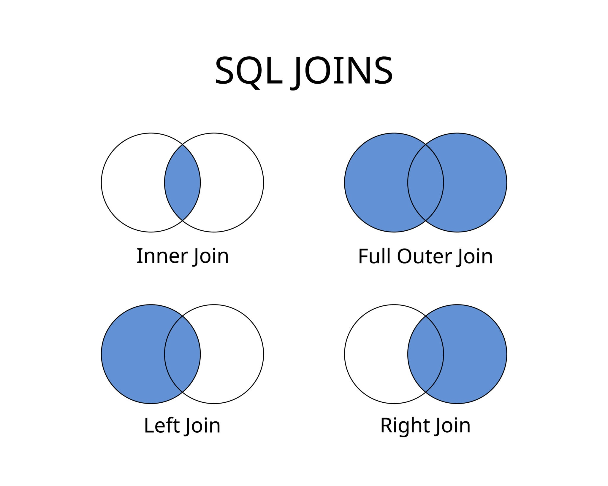

# SQL JOINs

A SQL JOIN clause is used to combine rows from two or more tables based on a related column between
them (usually a primary and a foreign key).



## Tables

Customers

| customer_id   |     name      |
| ------------- | ------------- |
| 1             |     Alice     |
| 2             |     Bob       |
| 3             |     Charlie   |

Orders

| order_id   |  customer_id  |
| -----------| ------------- |
| 101        |     1         |
| 102        |     1         |
| 103        |     3         |
| 104        |     4         |


```sql
create table customers(
    customer_id int primary key,
    name varchar(50) not null
);

create table orders(
    order_id int primary key,
    customer_id int not null
);

insert into customers(customer_id, name)
values (1,'Alice'),
       (2,'Bob'),
       (3,'Charlie');

insert into orders(order_id, customer_id)
values (101,1),
       (102,1),
       (103,3),
       (104,4);
```

## Cross join

```sql
-- Both are equivalent. Both produce the Cartesian product.
-- also both require where clause to filter, don't have ON 
SELECT *
FROM A, B;

SELECT *
FROM A
CROSS JOIN B;
```

## Inner join

```sql
-- gives rows that exist in both tables

SELECT *
FROM Customers c
INNER JOIN Orders o
    ON c.customer_id = o.customer_id;

-- both statements are equivalent
SELECT *
FROM Customers c
CROSS JOIN Orders o
    WHERE c.customer_id = o.customer_id;

-- joins 3 tables takes, teaches, instructor with takes and teaches having multiple foreign keys
select ta.id from
takes ta inner join teaches te
on ta.course_id=te.course_id 
and ta.sec_id=te.sec_id 
and ta.semester=te.semester 
and ta.year=te.year
inner join instructor i
on te.id=i.id
where i.name='Einstein'
```

| customer_id   |     name        | order_id | customer_id
| ------------- | -------------   | -------- | ----------- | 
| 1             |     Alice       | 101      | 1           |
| 1             |     Alice       | 102      | 1           |
| 3             |     Charlie     | 103      | 3           |

## Left join

```sql
- keep everything from left table and attach matches from right

SELECT *
FROM Customers c
INNER JOIN Orders o
    ON c.customer_id = o.customer_id;
```

| customer_id   |     name        | order_id | customer_id
| ------------- | -------------   | -------- | ----------- | 
| 1             |     Alice       | 101      | 1           |
| 1             |     Alice       | 102      | 1           |
| 3             |     Charlie     | 103      | 3           |
| 2             |     Bob         | null     | null        |

## Right join

Not much usable as you can swap tables and achieve the same results from left join.

| customer_id   |     name        | order_id | customer_id
| ------------- | -------------   | -------- | ----------- | 
| 1             |     Alice       | 101      | 1           |
| 1             |     Alice       | 102      | 1           |
| 3             |     Charlie     | 103      | 3           |
| null          |     null        | 104      | 4           |

## Full outer join

Keep everything from both sides

| customer_id   |     name        | order_id | customer_id
| ------------- | -------------   | -------- | ----------- | 
| 1             |     Alice       | 101      | 1           |
| 1             |     Alice       | 102      | 1           |
| 3             |     Charlie     | 103      | 3           |
| null          |     null        | 104      | 4           |
| 2             |     Bob         | null     | null        |

## Complex join

```sql
Write a solution to find the average time each machine takes to complete a process.

Input: 
Activity table:
+------------+------------+---------------+-----------+
| machine_id | process_id | activity_type | timestamp |
+------------+------------+---------------+-----------+
| 0          | 0          | start         | 0.712     |
| 0          | 0          | end           | 1.520     |
| 0          | 1          | start         | 3.140     |
| 0          | 1          | end           | 4.120     |
| 1          | 0          | start         | 0.550     |
| 1          | 0          | end           | 1.550     |
| 1          | 1          | start         | 0.430     |
| 1          | 1          | end           | 1.420     |
| 2          | 0          | start         | 4.100     |
| 2          | 0          | end           | 4.512     |
| 2          | 1          | start         | 2.500     |
| 2          | 1          | end           | 5.000     |
+------------+------------+---------------+-----------+
Output: 
+------------+-----------------+
| machine_id | processing_time |
+------------+-----------------+
| 0          | 0.894           |
| 1          | 0.995           |
| 2          | 1.456           |
+------------+-----------------+
Explanation: 
There are 3 machines running 2 processes each.
Machine 0's average time is ((1.520 - 0.712) + (4.120 - 3.140)) / 2 = 0.894
Machine 1's average time is ((1.550 - 0.550) + (1.420 - 0.430)) / 2 = 0.995
Machine 2's average time is ((4.512 - 4.100) + (5.000 - 2.500)) / 2 = 1.456

select machine_id , 
ROUND(AVG(end_time-start_time)::numeric,3) as processing_time
from(
select start_row.machine_id,
start_row.process_id,
start_row.timestamp as start_time,
end_row.timestamp as end_time
from Activity as start_row
join Activity as end_row
on start_row.machine_id = end_row.machine_id
and start_row.process_id = end_row.process_id
where start_row.activity_type = 'start'
and end_row.activity_type = 'end'
) as normalised_tbl
group by machine_id;

-- normalised_tbl : this was the major challenge
| machine_id | process_id | start_time | end_time |
| ---------- | ---------- | ---------- | -------- |
| 0          | 0          | 0.712      | 1.52     |
| 0          | 1          | 3.14       | 4.12     |
| 1          | 0          | 0.55       | 1.55     |
| 1          | 1          | 0.43       | 1.42     |
| 2          | 0          | 4.1        | 4.512    |
| 2          | 1          | 2.5        | 5        |
```

## Joining multiple tables

```sql
select s.student_id, s.student_name, sub.subject_name,
count(e.student_id) as attended_exams from 
Students s cross join Subjects sub
left join Examinations e
on s.student_id = e.student_id
AND e.subject_name = sub.subject_name
group by s.student_id, s.student_name, sub.subject_name
order by s.student_id, sub.subject_name;
```